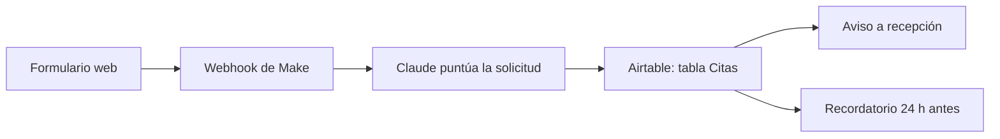

# Clínica Sonrisa · captación de citas (DEMO)

**Repo de práctica de la academia NexumIA.** Todo es ficticio: la clínica, las personas, los datos y las direcciones. Sirve para estudiar GitHub de básico a avanzado sin tocar nada real.

> [!WARNING]
> En este repo no hay ni debe haber claves reales. Si ves una, abre un issue y avisa.

## Qué hace (sistema ficticio)

Recoge las solicitudes de cita del formulario web de una clínica dental inventada. Claude puntúa cada solicitud, se guarda en Airtable y recepción recibe un aviso. Un día antes de la cita sale un recordatorio.

## Ficha

- Cliente: Clínica Sonrisa (ficticia)
- Responsable: @blacksideytf
- Estado: demo para estudiar
- Última revisión: 2026-11-11

## Cómo funciona

## Herramientas

| Herramienta | Para qué | Dónde está |
| --- | --- | --- |
| Make | Orquesta el flujo | `make/captura-leads.json` y `make/recordatorio-citas.json` |
| Claude | Puntúa la solicitud | `prompts/puntuar-lead.md` |
| Airtable | Guarda las citas | Base «Clínica Sonrisa», tabla «Citas» (ficticia) |
| Supabase | Guarda leads y recibe webhooks de GitHub | `supabase/` |
| GitHub Pages | Landing pública de la demo | `site/` |

## Claves (solo nombres, nunca valores)

| Clave | Dónde viviría | Quién la rota |
| --- | --- | --- |
| `AIRTABLE_TOKEN` | Conexión en Make | @blacksideytf |
| `ANTHROPIC_API_KEY` | Keychain de Make | @blacksideytf |
| `SUPABASE_SERVICE_ROLE_KEY` | Supabase secrets | @blacksideytf |
| `MAKE_WEBHOOK_URL` | GitHub Secrets (Actions) | @blacksideytf |

## Mapa del repo: qué se estudia en cada sitio

| Archivo o carpeta | Para qué sirve | Módulo · lección |
| --- | --- | --- |
| `README.md` | Portada y documentación del sistema | Básico · 6 |
| `.gitignore` y `.env.example` | Qué no se sube nunca y qué variables hacen falta | Básico · 2 |
| `make/` | Blueprints de ejemplo para ver el historial y el diff | Básico · 1, 3 y 4 |
| `prompts/` | Prompts versionados, uno por archivo | Básico · 3 y 4 |
| `.github/ISSUE_TEMPLATE/` | Plantilla de tareas | Básico · 7 |
| `.github/pull_request_template.md` | Plantilla de pull request | Medio · 3 |
| `.github/release.yml` | Categorías de las notas de cada release | Medio · 8 |
| `.github/workflows/hola.yml` | Primer workflow | Avanzado · 1 |
| `.github/workflows/diario.yml` | Workflow programado con secreto | Avanzado · 2 |
| `.github/workflows/comprobaciones.yml` | Checks en cada pull request | Avanzado · 3 |
| `.github/CODEOWNERS` | Quién revisa cada carpeta | Avanzado · 4 |
| `.github/dependabot.yml` | Mantener las acciones al día | Avanzado · 5 |
| `.github/workflows/pages.yml` y `site/` | Publicar una web | Avanzado · 6 |
| `supabase/functions/github-webhook/` | Receptor seguro de webhooks | Avanzado · 7 |
| `.devcontainer/` | Entorno de Codespaces | Avanzado · 9 |
| `CLAUDE.md` | Reglas del repo para Claude | GitHub + Claude · 4 |
| `.github/workflows/claude.yml` | @claude en issues y PR | GitHub + Claude · 6 |
| `REVIEW.md` | Qué mirar en Code Review | GitHub + Claude · 7 |
| `docs/` | Runbook, política de uso y ejercicios | Todos |

## Ejemplos ya montados

- Issues con la plantilla y etiquetas, abiertas y cerradas.
- Un pull request fusionado con «Squash and merge» que cerró su issue con `Closes #N`.
- Un pull request abierto con un blueprint roto a propósito: su check sale en rojo.
- Un historial con commits `docs:`, `feat:`, `fix:` y `chore:`, incluido un `fix:` que corrige un filtro de Make.

La lista de ejercicios está en [docs/ejercicios.md](docs/ejercicios.md).

## Puesta en marcha (para practicar)

- [ ] Clonar el repo con GitHub Desktop o `gh repo clone`
- [ ] Crear tu rama y hacer un cambio pequeño
- [ ] Abrir un pull request con la plantilla y ver los checks
- [ ] Opcional: guardar un secreto `MAKE_WEBHOOK_URL` de prueba y lanzar «Tareas diarias» con «Run workflow»

## Si algo falla

- Mira primero la pestaña «Actions» y el log del paso en rojo.
- Abre un issue con la plantilla «Tarea o petición».
- Contacto: @blacksideytf

## Contacto

- Canal: issues de este repo, con la plantilla «Tarea o petición»
- Horario de respuesta (ficticio): de lunes a viernes, de 9:00 a 18:00
- Responsable: @blacksideytf

## Cambios

El historial completo está en los commits del repo.
