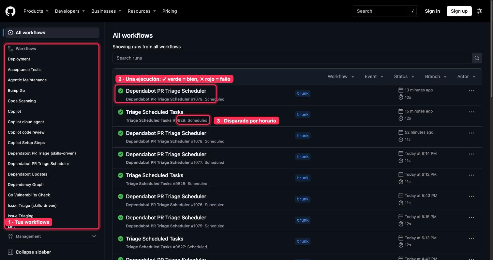
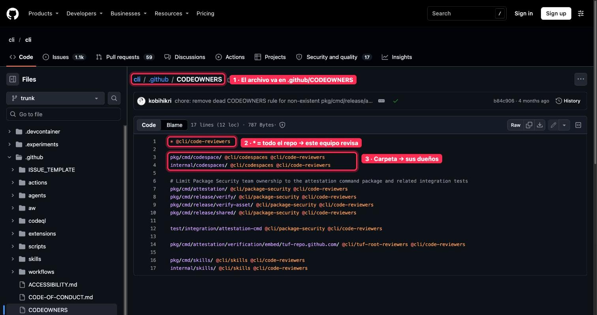
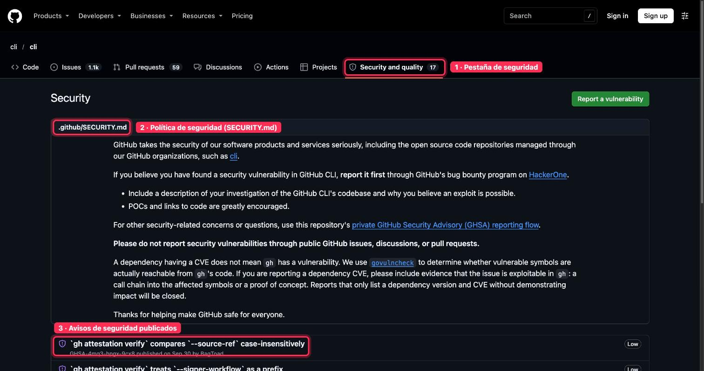
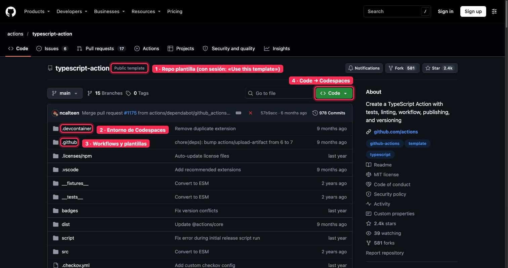

# Dónde mirar · 🟣 AVANZADO · Automatiza, protege y publica

Guía rápida de **dónde mirar en GitHub** en cada lección del módulo. Las capturas son de repositorios públicos, con lo importante marcado en rojo y numerado igual que en el texto. Las pantallas que piden iniciar sesión van solo con la ruta.

[← Volver al índice](README.md)

## 1 · GitHub Actions y 2 · Workflows programados

**Dónde mirar:** la pestaña Actions de un repo, por ejemplo [github.com/cli/cli/actions](https://github.com/cli/cli/actions).

**Qué ver:** (1) la lista de workflows, (2) cada ejecución (✓ verde = bien, ✗ rojo = fallo; pulsa una para ver el log) y (3) las que se disparan por horario. Los secretos se guardan en «Settings → Secrets and variables → Actions» (pide iniciar sesión).

## 3 · Comprobaciones en cada pull request

**Dónde mirar:** la pestaña Checks de un PR, por ejemplo [github.com/github/gitignore/pull/4882/checks](https://github.com/github/gitignore/pull/4882/checks), o el final de su pestaña Conversation.

## 4 · Proteger main: rulesets y CODEOWNERS

**Dónde mirar:** el ruleset se crea en «Settings → Rulesets» (pide iniciar sesión). El archivo CODEOWNERS sí se ve en público, por ejemplo [github.com/cli/cli/blob/trunk/.github/CODEOWNERS](https://github.com/cli/cli/blob/trunk/.github/CODEOWNERS).

**Qué ver:** (1) va en .github/CODEOWNERS, (2) * significa todo el repo y (3) cada carpeta con sus dueños.

## 5 · Seguridad del repositorio

**Dónde mirar:** la pestaña de seguridad, por ejemplo [github.com/cli/cli/security](https://github.com/cli/cli/security). Dependabot y push protection se activan en «Settings → Advanced Security» (pide iniciar sesión).

**Qué ver:** (1) la pestaña Security and quality, (2) la política de seguridad (SECURITY.md) y (3) los avisos publicados.

## 6 · Publicar desde GitHub

**Dónde mirar:** «Settings → Pages → Build and deployment → Source: GitHub Actions» (pide iniciar sesión). La web publicada es pública aunque el repo sea privado.

## 7 · Webhooks y la API

- Webhook: «Settings → Webhooks → Add webhook»; los envíos se ven en «Recent deliveries»
- Token para Make o n8n: «Settings → Developer settings → Personal access tokens → Fine-grained tokens»

Estas pantallas piden iniciar sesión, por eso no llevan captura.

## 8 · Plantillas y 9 · Codespaces

**Dónde mirar:** un repo plantilla, por ejemplo [github.com/actions/typescript-action](https://github.com/actions/typescript-action). Tus codespaces se gestionan en [github.com/codespaces](https://github.com/codespaces).

**Qué ver:** (1) la marca de plantilla (con sesión iniciada aparece «Use this template»), (2) la carpeta .devcontainer con el entorno de Codespaces, (3) la carpeta .github con workflows y plantillas y (4) el botón Code, con la pestaña Codespaces.

## 10 · Entregable

Un repo plantilla «llave en mano» para clientes: ruleset en main, checks en los PR, un workflow programado con secreto, Dependabot y la web publicada. Se comparte en los comentarios de su lección.
