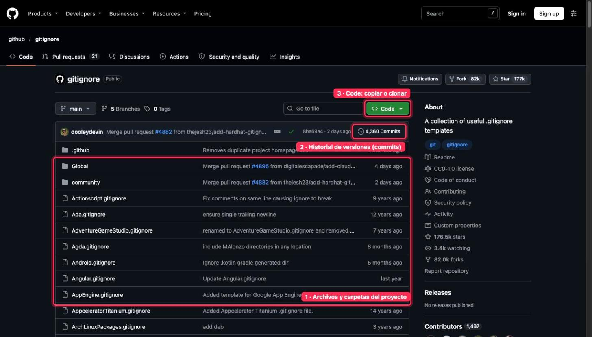
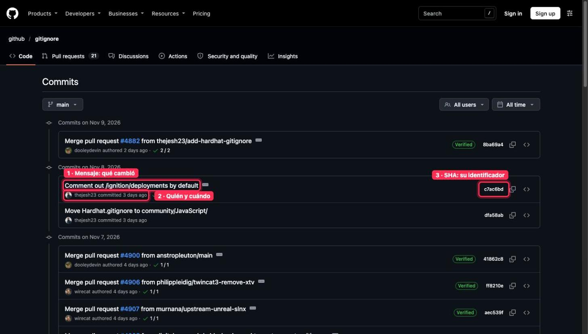
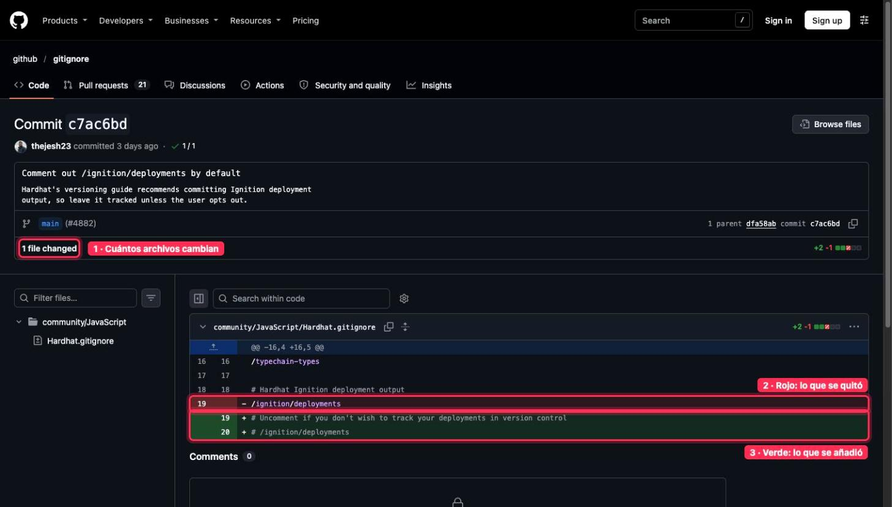
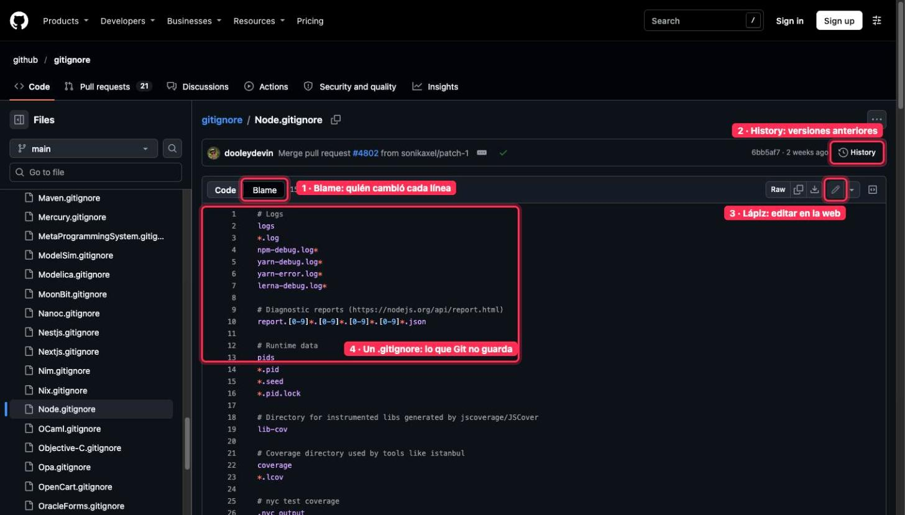
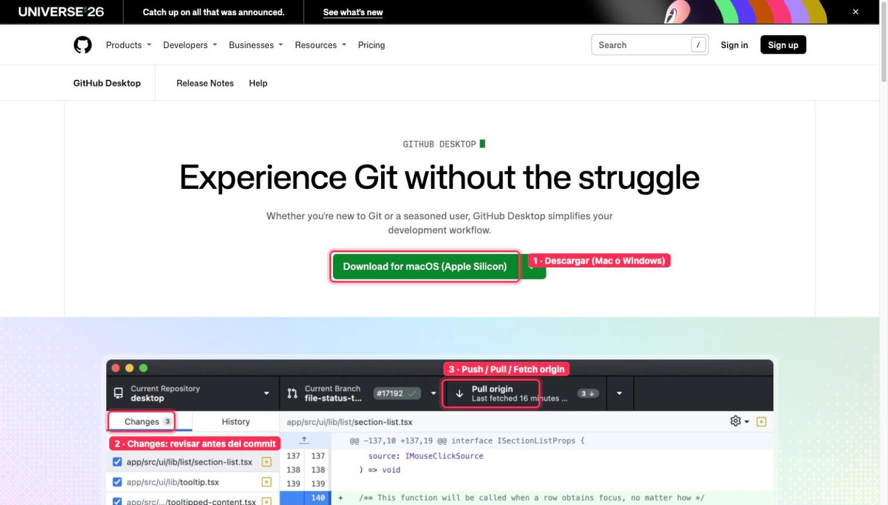
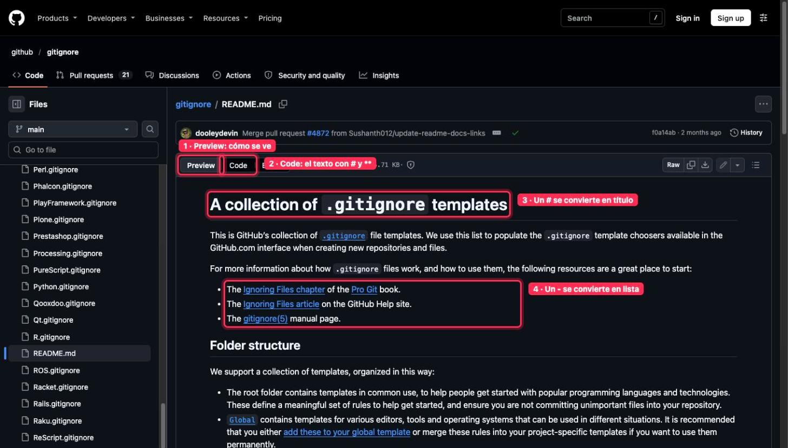
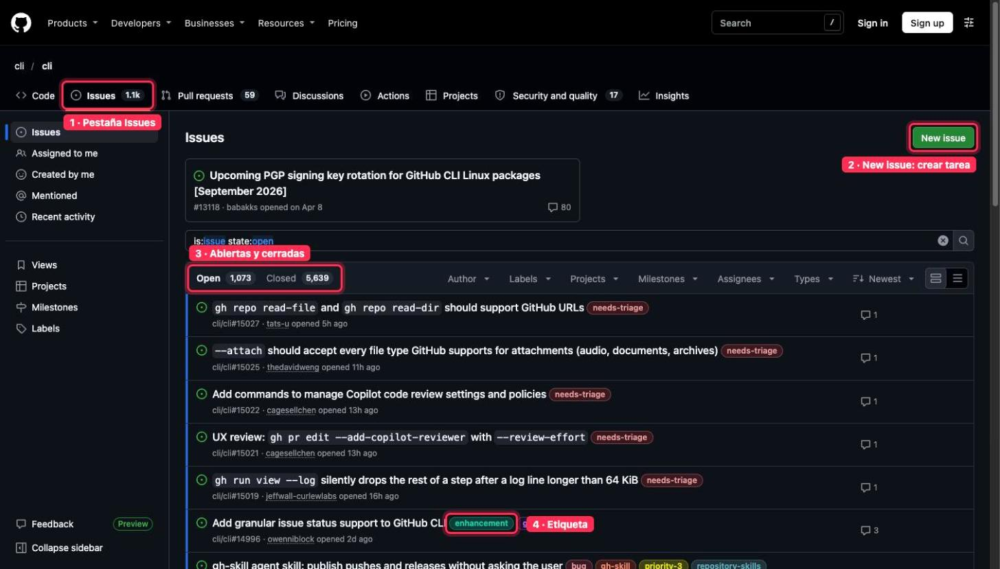

# Dónde mirar · 🟢 BÁSICO · Tu trabajo, versionado y a salvo

Guía rápida de **dónde mirar en GitHub** en cada lección del módulo. Las capturas son de repositorios públicos, con lo importante marcado en rojo y numerado igual que en el texto. Las pantallas que piden iniciar sesión van solo con la ruta.

[← Volver al índice](README.md)

## 1 · Qué es Git y GitHub

**Dónde mirar:** la página principal de un repo, por ejemplo [github.com/github/gitignore](https://github.com/github/gitignore).

**Qué ver:** (1) los archivos y carpetas, (2) el historial de versiones (commits) y (3) el botón Code para descargar o clonar.

## 2 · Tu cuenta y tu primer repositorio

- Crear cuenta: [github.com/signup](https://github.com/signup)
- Crear repo: [github.com/new](https://github.com/new) → elige «Private» y añade README y .gitignore
- Verificación en dos pasos: [github.com/settings/security](https://github.com/settings/security) → «Enable two-factor authentication»

Estas pantallas piden iniciar sesión, por eso no llevan captura.

## 3 · Commits: guardar versiones

**Dónde mirar:** el historial, por ejemplo [github.com/github/gitignore/commits/main](https://github.com/github/gitignore/commits/main), y un commit por dentro, por ejemplo [este cambio](https://github.com/github/gitignore/commit/c7ac6bd).

**Qué ver:** en el historial, (1) el mensaje, (2) quién y cuándo y (3) el SHA. Dentro del commit, el rojo es lo que se quitó y el verde lo que se añadió.

## 4 · Trabajar desde la web

**Dónde mirar:** cualquier archivo, por ejemplo [Node.gitignore](https://github.com/github/gitignore/blob/main/Node.gitignore) (también sirve para ver qué es un .gitignore).

**Qué ver:** (1) Blame, quién cambió cada línea; (2) History, las versiones anteriores; (3) el lápiz, para editar. En tu repo: «Add file → Create new file» o «Upload files». La tecla «.» abre el repo en github.dev.

## 5 · GitHub Desktop

**Dónde mirar:** [desktop.github.com](https://desktop.github.com) (macOS y Windows, no Linux).

**Qué ver:** (1) la descarga, (2) «Changes» para revisar antes del commit y (3) el botón de arriba, que cambia entre Push, Pull y Fetch origin. Para iniciar sesión: en Mac «GitHub Desktop → Settings → Accounts»; en Windows «File → Options → Accounts».

## 6 · Markdown y README

**Dónde mirar:** un README, por ejemplo [README.md](https://github.com/github/gitignore/blob/main/README.md).

**Qué ver:** (1) Preview muestra cómo se ve y (2) Code el texto con símbolos. Un (3) # se convierte en título y un (4) - en lista.

## 7 · Issues

**Dónde mirar:** la pestaña Issues de un repo, por ejemplo [github.com/cli/cli/issues](https://github.com/cli/cli/issues).

**Qué ver:** (1) la pestaña Issues, (2) New issue para crear una tarea, (3) abiertas y cerradas y (4) las etiquetas. Una issue se cierra sola si un commit dice «Closes #N».

## 8 · Entregable

Un repo privado de un sistema real: carpetas, blueprints, README, issues y commits con buen mensaje, y ni una sola clave. Se comparte en los comentarios de su lección.
