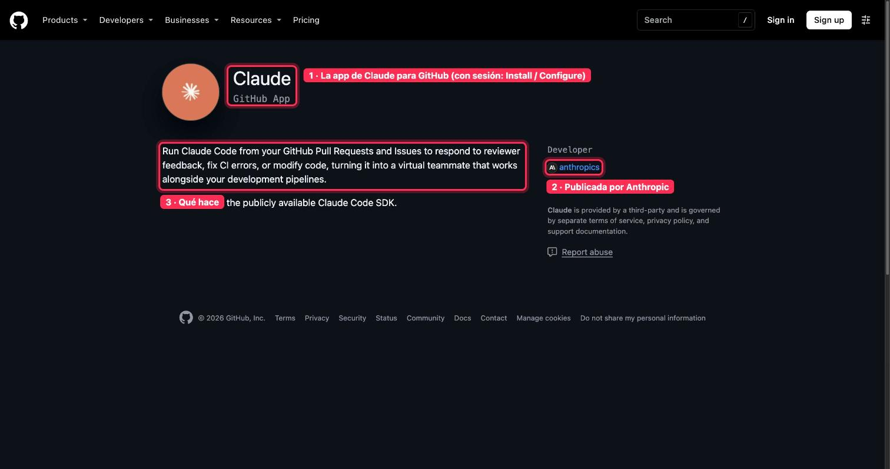
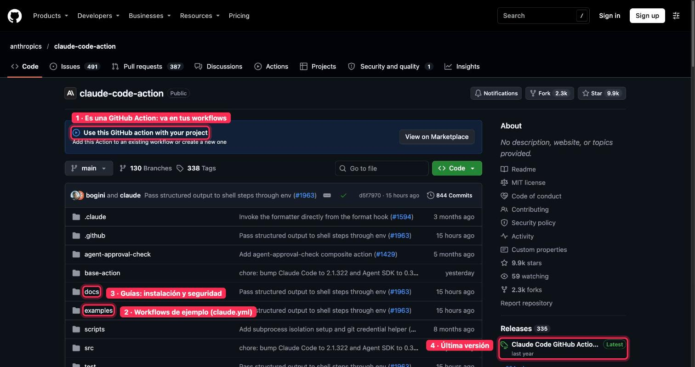

# Dónde mirar · 🤖 GitHub + Claude de empresa

Guía rápida de **dónde mirar en GitHub** en cada lección del módulo. Las capturas son de repositorios públicos, con lo importante marcado en rojo y numerado igual que en el texto. Las pantallas que piden iniciar sesión van solo con la ruta.

[← Volver al índice](README.md)

## 1 · Las cinco formas de trabajar con Claude en GitHub

Proyecto de claude.ai (solo lee), Claude Code en tu equipo, Claude Code en la nube, @claude con GitHub Actions y Code Review. Cada una se mira en un sitio distinto, que tienes abajo.

## 2 · Repos en chats y proyectos

**Dónde mirar:** en claude.ai, «+ → Add from GitHub» en un chat, o «+ → GitHub» en el conocimiento de un proyecto. Para repos de una organización con SSO: github.com/settings/applications → Claude → «Grant».

Pide iniciar sesión, por eso no lleva captura.

## 3 · La app de Claude en tu organización

**Dónde mirar:** [github.com/apps/claude](https://github.com/apps/claude).

**Qué ver:** (1) la app (con sesión iniciada aparecen Install y Configure), (2) que la publica Anthropic y (3) qué hace. Después se revisa en «Settings → GitHub Apps» de la organización.

## 4 · Claude Code en tu repositorio

**Dónde mirar:** el archivo CLAUDE.md en la raíz de tu repo y la terminal con gh autenticado (gh auth login).

## 5 · Claude Code en la nube

**Dónde mirar:** [claude.ai/code](https://claude.ai/code) (pide iniciar sesión). Desde la terminal: claude --cloud.

## 6 · @claude con GitHub Actions

**Dónde mirar:** [github.com/anthropics/claude-code-action](https://github.com/anthropics/claude-code-action).

**Qué ver:** (1) es una GitHub Action que va en tus workflows, (2) la carpeta examples con claude.yml, (3) la carpeta docs con instalación y seguridad y (4) la última versión. Instalación rápida: /install-github-app dentro de Claude Code.

## 7 · Code Review

**Dónde mirar:** en claude.ai, «Admin settings → Claude Code → Code review» (solo un Owner, planes Team y Enterprise). Documentación: [code.claude.com/docs/en/code-review](https://code.claude.com/docs/en/code-review).

## 8 · Gobierno, 9 · Casos de uso y 10 · Entregable

Política de uso, casos reales y el runbook final. Todo se apoya en los sitios de arriba: la app, el workflow claude.yml y los ajustes de Code Review.
