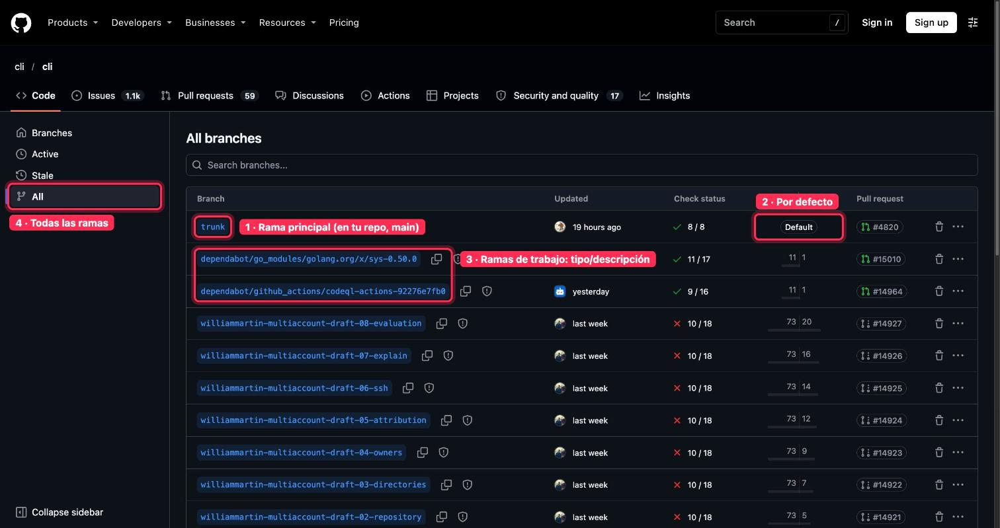
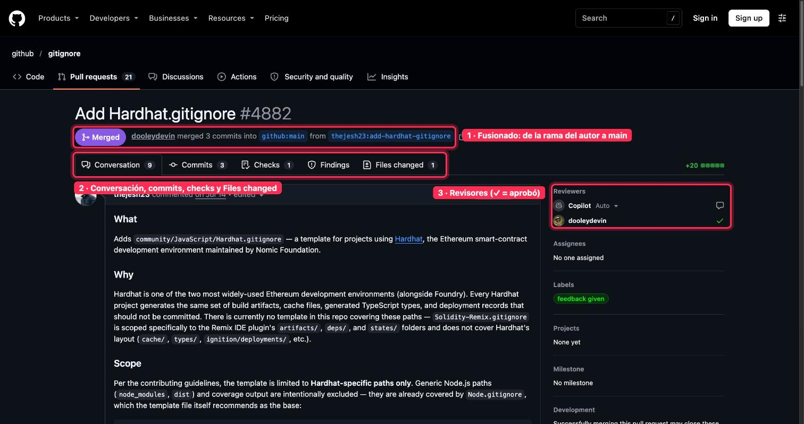
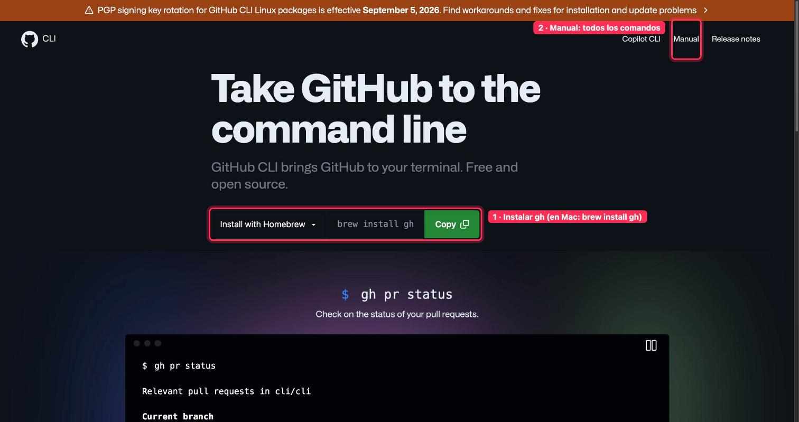
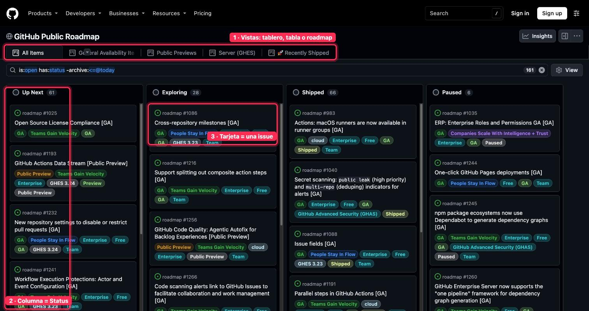
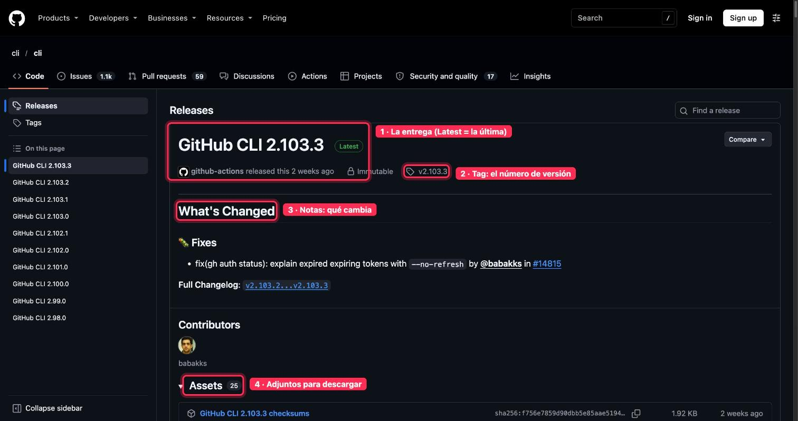

# Dónde mirar · 🔵 MEDIO · Trabajar en equipo sin pisarse

Guía rápida de **dónde mirar en GitHub** en cada lección del módulo. Las capturas son de repositorios públicos, con lo importante marcado en rojo y numerado igual que en el texto. Las pantallas que piden iniciar sesión van solo con la ruta.

[← Volver al índice](README.md)

## 1 · Ramas

**Dónde mirar:** la página de ramas de un repo, por ejemplo [github.com/cli/cli/branches/all](https://github.com/cli/cli/branches/all).

**Qué ver:** (1) la rama principal (en tu repo se llama main), (2) la marca de rama por defecto, (3) las ramas de trabajo con nombre tipo/descripción y (4) el filtro para verlas todas. Para crear una: GitHub Desktop «Current Branch → New Branch», o el desplegable de ramas en la web.

## 2 · Pull requests

**Dónde mirar:** un pull request, por ejemplo [github.com/github/gitignore/pull/4882](https://github.com/github/gitignore/pull/4882).

**Qué ver:** (1) el estado y de qué rama va a main, (2) las pestañas Conversation, Commits, Checks y Files changed, y (3) los revisores (✓ = aprobó). Para abrir uno: el aviso «Compare & pull request» al subir una rama.

## 3 · Revisar código y documentos

**Dónde mirar:** la pestaña «Files changed» de un PR (punto 2 de la captura anterior). Pasa el ratón por un número de línea y pulsa el icono azul de comentario. Para cerrar la revisión: «Review changes» → Comment, Approve o Request changes.

Comentar y revisar pide iniciar sesión, por eso no lleva captura propia.

## 4 · Conflictos de merge

**Dónde mirar:** el botón «Resolve conflicts» al final de un PR con conflicto. Si está desactivado, se resuelve en tu ordenador con VS Code («Accept Current Change», «Accept Incoming Change»…).

Solo aparece en un PR con conflicto, por eso no lleva captura.

## 5 · La terminal mínima

**Dónde mirar:** [cli.github.com](https://cli.github.com).

**Qué ver:** (1) cómo instalar gh (en Mac, brew install gh) y (2) el manual con todos los comandos. Lo primero después de instalar: gh auth login.

## 6 · Organizaciones, equipos y permisos

- Crear organización: [github.com/account/organizations/new](https://github.com/account/organizations/new)
- Dar acceso en un repo: «Settings → Collaborators & teams → Add people»
- Roles, de menos a más: Read, Triage, Write, Maintain y Admin

Estas pantallas piden iniciar sesión, por eso no llevan captura.

## 7 · GitHub Projects

**Dónde mirar:** un tablero público, por ejemplo [github.com/orgs/github/projects/4247](https://github.com/orgs/github/projects/4247).

**Qué ver:** (1) las vistas (tablero, tabla o roadmap), (2) cada columna es un Status y (3) cada tarjeta es una issue.

## 8 · Releases y tags

**Dónde mirar:** la página de releases, por ejemplo [github.com/cli/cli/releases](https://github.com/cli/cli/releases).

**Qué ver:** (1) la entrega (Latest = la última), (2) el tag con el número de versión, (3) las notas de qué cambia y (4) los adjuntos. Para crear una: «Releases → Draft a new release».

## 9 · Entregable

Un cambio de punta a punta con un compañero: issue, rama, PR con revisión, merge, release y tarjeta en «Done». Se comparte en los comentarios de su lección.
